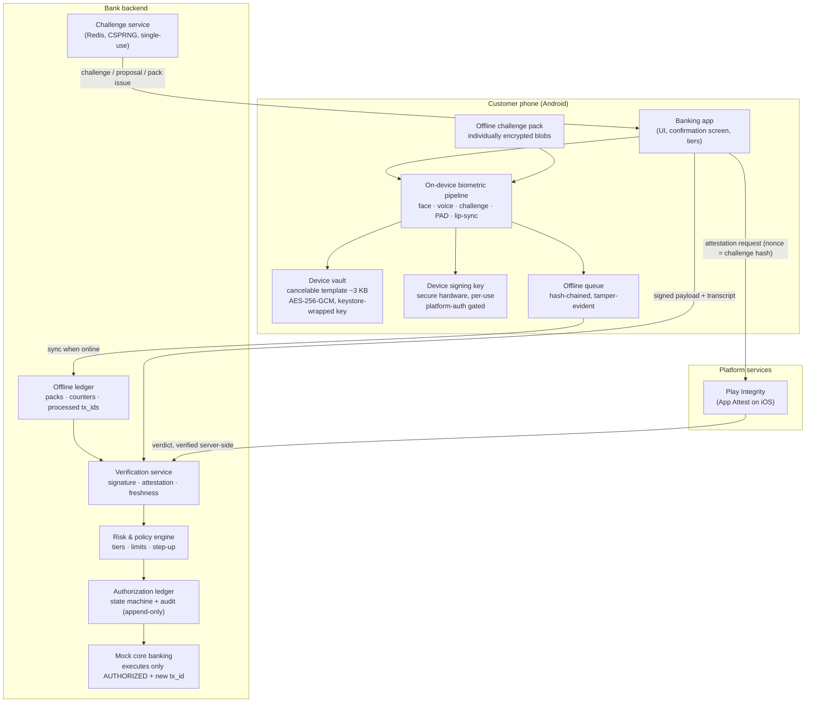
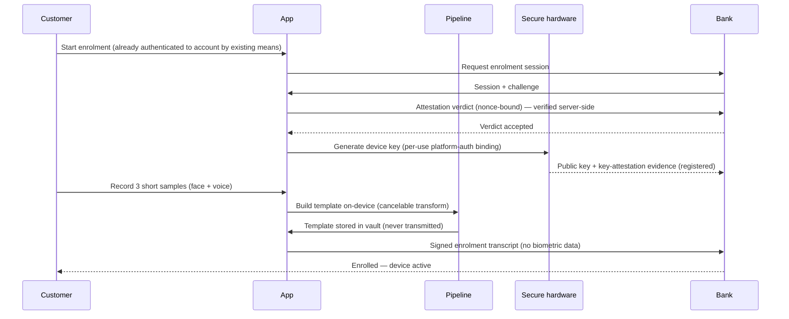
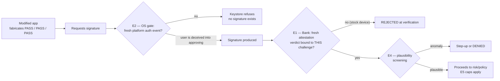
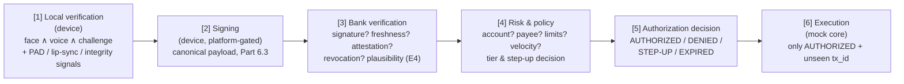
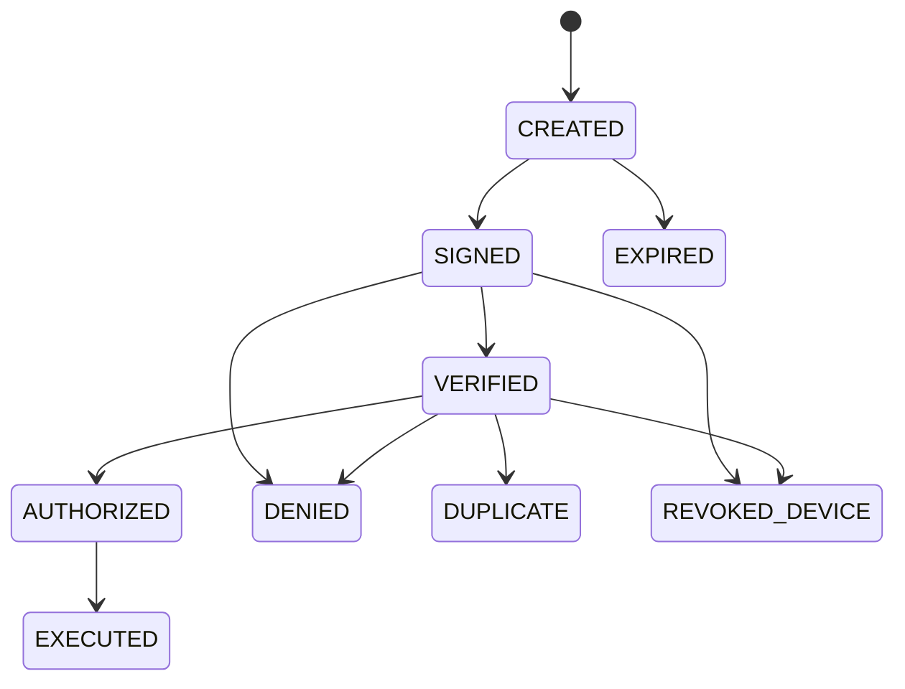
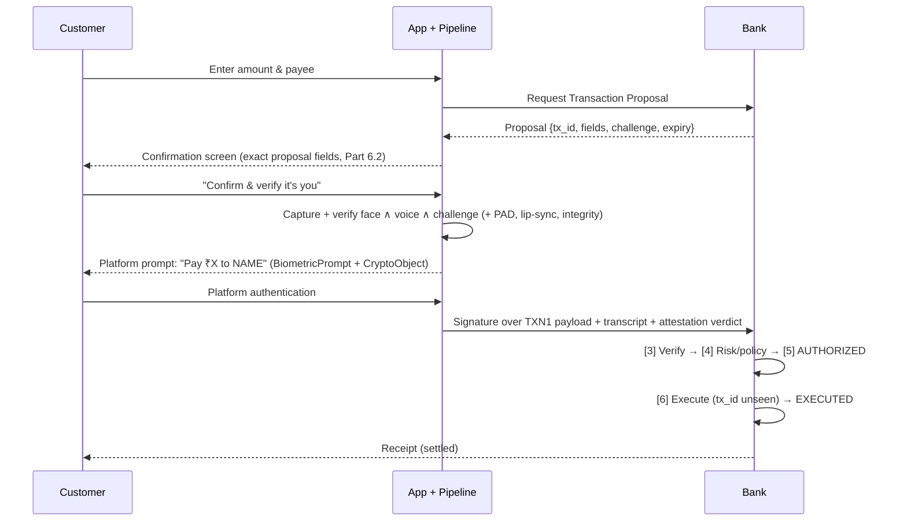
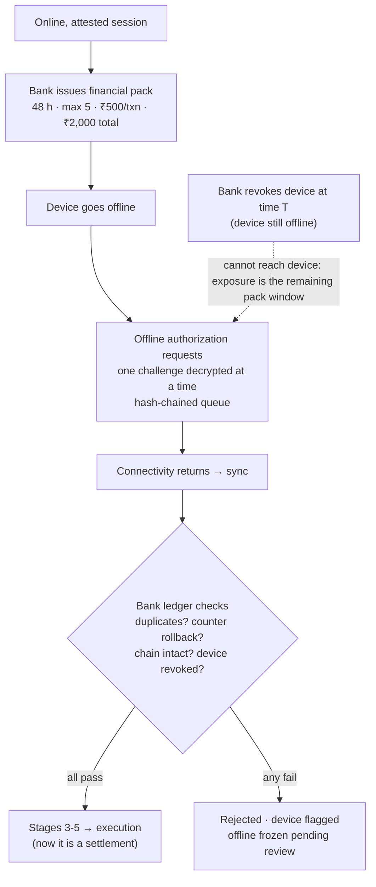
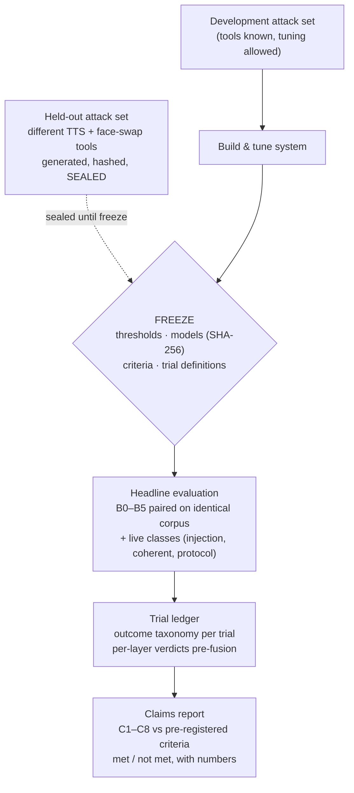

# Secure Transaction Authorization Using Multimodal Biometrics
## Final Consolidated Design Document — From Research Paper to Bank-Grade Prototype

| | |
|---|---|
| **Author** | Kanika |
| **Origin** | Extension of the submitted conference paper *"Secure User Authentication Scheme Using Multimodal Biometrics"* (draft 7) |
| **Purpose** | A single, complete specification of the follow-up system: a bank prototype that authorizes transactions using face + voice + spoken challenge, designed to be **deepfake-resistant, scalable, and offline-capable** — and, above all, *provable* |
| **Status** | Specification Baseline 1.0 — **frozen** 25 Oct 2026 (SHA-256 record: `FREEZE-RECORD.md`). Issues 1 & 2 are *specification-closed, technically open* (they close only when their tests produce evidence) |
| **Review history** | Four external review rounds were received and adopted; every major design decision in this document traces to either a measured result, a regulation, or a review point — and says which |

**How to read this document.** Parts 1–2 explain *where this came from* and *why a redesign was necessary*. Parts 3–4 specify *what is being built*. Parts 5–8 specify *how it works and why each mechanism exists*. Parts 9–11 specify *how every claim will be proven*. Parts 12–15 give the test catalogue, the build order, the honest limitations, and the demonstration script. A reader in a hurry can read Part 0, the diagrams, and Part 14 (limitations) and still know exactly what this system does and does not claim.

---

# Part 0 — Executive Summary

The submitted research paper built a working authentication system: from **one video stream**, it verifies a user's **face** (deep embeddings, cosine similarity), their **voice** (speaker embeddings), and a **server-issued 5-digit spoken challenge** — all three must pass. It proved the combination is highly resistant to ordinary impostors (zero false accepts in over half a million impostor trials) and it honestly exposed its own biggest weakness: without any liveness/anti-spoofing defence, **synthetic and replayed voices were accepted 72–76% of the time**.

This document designs the follow-up: the same multimodal idea, rebuilt as a **bank transaction-authorization protocol**. Three structural changes turn the college login system into something a bank could evaluate:

1. **The biometrics move onto the customer's phone and never leave it.** The bank stores no recordings and no biometric templates — only a cryptographic public key (~200 bytes per customer). The phone proves "the right person, on the right device, approved *this exact transaction*" by signing it. *Why:* a bank-side biometric database is a breach liability, a regulatory problem, and a scaling bottleneck all at once; a public key is none of those.
2. **Deepfake defence is layered and measured, not asserted.** Face presentation-attack detection, voice anti-spoofing, audio-visual (lip-sync) consistency, and capture-integrity checks each produce their own verdict, and the evaluation measures their **joint** performance — including on attacks built with tools the developers never tuned against, and including an attack class (coherent real-time impersonation) designed to defeat all layers *simultaneously*. *Why:* layers that fail together provide far less protection than layers that fail independently, and only measurement can tell the difference.
3. **Offline authorization is bounded, queued, and reconciled — never "settled offline."** A phone without connectivity can record authorization requests against a short-lived, bank-signed challenge pack (**48 hours · max 5 · ₹500 per transaction · ₹2,000 total** — frozen configuration). The bank's server ledger is the final authority when the phone reconnects; duplicates, replays and rolled-back state are rejected there. *Why:* a disconnected bank cannot check anything live, so the design's job is to bound exactly how much damage that window permits — in time, count, and rupees — and to publish the measured bound.

Everything is organised around **three properties the prototype must prove** (not fifteen features it must demonstrate):

| Property | Statement | Proven by |
|---|---|---|
| **P1** | The bank can verify transaction-specific authorizations **without ever receiving or storing biometric data** | Privacy data-flow audit (Part 10), transaction substitution/replay tests (Part 12) |
| **P2** | **Layered deepfake defences measurably reduce attack acceptance** versus any single layer, at an acceptable cost to genuine users | Paired baseline comparison B0–B5 on a sealed held-out attack set (Part 11) |
| **P3** | **Offline authorization works and its risk is bounded and measured** | Rollback/duplicate/revocation-window tests with published numbers (Parts 8, 12) |

And one discipline governs the whole project: **every claim is either supported by a named piece of evidence, or explicitly downgraded. There is no third option.**

---

# Part 1 — Background: The Submitted System (Version 1)

## 1.1 What version 1 does

Version 1 (the submitted paper) is a client–server authentication system:

1. **Enrolment.** The user records one video. The server extracts a face template and a voice template from it and stores them **encrypted** (AES-256-GCM, per-user keys held in a separate server-side key vault). Raw media is discarded; only templates are stored.
2. **Login.** The server issues a random **5-digit challenge**. The user records a video of themselves speaking those digits. From that single stream the server extracts all three factors:
   - **Face:** 512-dimensional deep face embeddings; cosine similarity against the enrolled template; threshold τf = 0.35.
   - **Voice:** ECAPA-TDNN speaker embeddings (192-dimensional, 16 kHz mono audio); cosine similarity; threshold τa = 0.30.
   - **Challenge:** automatic speech recognition must find the expected digit string in what was spoken — proving the recording is *fresh*, not lifted from an old video.
3. **Decision.** Strict logical AND: face ∧ voice ∧ challenge. Any single failure rejects the login.

**Technology stack (v1):** React client · Express/Node 22 server · MongoDB · Python 3.12 biometric pipeline · ONNX Runtime inference.

## 1.2 What version 1 measured (the evidence base this design builds on)

| Result | Value | Interpretation |
|---|---|---|
| Voice-only equal error rate (CREMA-D, main protocol) | **3.15%** (95% CI [2.60%, 3.71%], at threshold 0.267) | The voice factor alone is a solid verifier |
| Combined face ∧ voice false rejection | **6.13%** (364 / 5,941 genuine trials) | ~1 in 16 genuine logins fails — usable, improvable |
| Combined observed false acceptance | **0 / 583,214** impostor trials | Excellent against *ordinary* impostors |
| **Voice spoof acceptance (ASVspoof 2019)** | **72.10% (logical access) · 76.17% (physical access)** | **The critical weakness:** no liveness/anti-spoofing exists; the challenge proves freshness of the *recording session*, not liveness of the *speaker* |
| Genuine pass rate, different-emotion protocol | FRR **22.71%** | Emotional variation in voice is a real-world FRR driver |
| Login duration | **≈27 s total** (≈20 s of user speaking, ≈6.8 s server processing) | Too slow to impose on every banking interaction (→ risk-adaptive tiers, Part 3) |
| Template size | **≈147 KB per user** | Far too large for device-side storage at scale (→ slim template ~3 KB, Part 4) |
| Challenge generation | `Math.random` — digits measurably non-uniform, effective entropy ≈16.4 bits | A prototype shortcut, unacceptable in a security protocol (→ CSPRNG, Part 5) |

## 1.3 The audit findings that shaped version 2

An audit of draft 7 (before the extension began) found, in order of importance:

1. **The three-factor system had never been measured as a three-factor system.** No dataset used contains face + voice + spoken digits together (CREMA-D has no digit speech; ASVspoof has no face), so no complete FAR/FRR/EER exists for the actual product configuration. → *Fixed by the evaluation design in Part 11 (purpose-recorded corpus + paired configuration comparison).*
2. **No ablation study** — the contribution of each factor was never isolated. → *Fixed by configurations B0–B5 (Part 11.3).*
3. **Face-only performance never reported.** → *Same fix.*
4. **Weak challenge randomness** (`Math.random`). → *CSPRNG everywhere (Part 5.6).*
5. **No attempt throttling or lockout anywhere** — an attacker could retry indefinitely. → *Server-enforced attempt policy (Part 5.6).*
6. **Challenge verification accepted any matching speech-recognition hypothesis**, unquantified. → *Grammar-constrained digit recognition + confidence recorded in the transcript (Part 4).*
7. **Single-recording enrolment** — one video is a fragile template source. → *3-sample enrolment (Part 4).*
8. **No presentation-attack detection at all** (the 72–76% spoof numbers). → *The entire deepfake layer (Part 7).*

---

# Part 2 — Why a Bank Changes Everything

The professor's follow-up questions — *can it work offline? can it scale? could a bank use it?* — sound like feature requests. They are not. Each one breaks an assumption version 1 was built on, and the redesign follows from taking the breakage seriously.

## 2.1 The five hard questions (the design's real specification)

1. How does the bank know the customer authorized **this specific transaction** — not just "logged in at some point"?
2. How do we prevent a **compromised application** from bypassing the biometric checks and misusing the customer's credentials?
3. How can **offline** authentication resist replay attacks without a live server challenge?
4. How do we demonstrate the **deepfake defences** work against attacks they weren't specifically designed around?
5. How do we prove that adding customers does **not** proportionally increase the bank's biometric-compute requirements?

Parts 5–8 answer questions 1–3 and 5 by design; Parts 10–12 answer question 4, and all five, by measurement.

## 2.2 Why the bank cannot hold the biometrics

Version 1's architecture — server stores encrypted templates, server runs the matching — fails a bank on four independent grounds, any one of which is sufficient:

| Problem | Explanation |
|---|---|
| **Breach liability** | A central database of biometric templates for millions of customers is an irreversible breach target: passwords can be reissued, faces cannot. Encryption helps only while keys and data stay separated under attack. |
| **Regulation** | India's DPDP Act and banking practice push strongly toward data minimisation; collecting raw biometrics centrally invites the highest tier of obligation. |
| **Scaling** | Server-side matching costs ~6.5 s of inference per login in v1. At bank scale that is a compute farm proportional to logins. (Quantified in Part 9.) |
| **Trust** | Customers and regulators increasingly expect the FIDO/passkey pattern: biometrics unlock something *on the device*; they are not themselves transmitted. |

**The redesign (the FIDO2 pattern, generalised):** verification happens **on the customer's device**; what the device produces is not a "PASS" message — which any compromised app could fake — but a **cryptographic signature** over the specific authorization, produced by a hardware-protected key that the platform only releases after its own user-authentication check. The bank verifies one signature (sub-millisecond) and stores one public key (~200 bytes). At 100 million customers that is ≈20 GB of public keys, versus ≈14.7 TB of v1-style server templates — and, more importantly, **zero biometric data to breach**.

## 2.3 Regulatory alignment (India)

The design maps onto the Reserve Bank of India's *Authentication Mechanisms for Digital Payment Transactions Directions, 2025* (in force 1 April 2026):

| RBI requirement | How this design satisfies it |
|---|---|
| Two-factor authentication for digital payments | Possession (device-bound hardware key) + inherence (face ∧ voice), as independent factors |
| Biometrics count as "something you are" | Face and voice are the inherence factor; the spoken challenge binds them to a fresh session |
| At least one factor must be **dynamic** (non-replayable) | The bank's single-use challenge is inside the signed payload; offline, the signed challenge pack provides the dynamic element within its bounded window |
| Factors must be independent | Compromising the app does not yield the key (hardware); extracting the key is prevented by secure hardware; the factors fail independently by construction |
| Risk-based additional checks permitted/encouraged | The tier system (Part 3.2) and step-up outcomes (Part 11.1) are exactly this |

Offline limits follow RBI's *Framework for Facilitating Small Value Digital Payments in Offline Mode*: ₹500 per transaction, ₹2,000 total per instrument. The prototype's frozen configuration (Part 8.5) adopts these directly.

---

# Part 3 — Product Specification

## 3.1 Scope discipline: three properties, and a deferred list

The single most consequential product decision in this project is a **cut**. The prototype exists to prove P1, P2, P3 (Part 0). Everything that does not serve those properties is deferred — named here so it cannot quietly creep back:

> **Deferred (out of the prototype):** branch-kiosk mode and any 1:N face gallery/FAISS search · multi-language challenges · action (head-turn) challenges · assisted/branch enrolment · customer self-service device-management panel (device revocation exists, admin-side) · a full policy console (policy is a versioned config file; the console is a read-only audit and attempts viewer) · an offline stored-balance *pocket/wallet* (offline scope is queued *authorization requests*, settled online after sync) · iOS build (Android first; iOS is designed-for in every protocol rule and built later).

*Why:* a working demonstration of fifteen components with none of them validated is this project's named failure mode. Three proven properties are a paper and a product foundation; fifteen demos are neither.

## 3.2 Risk-adaptive authentication tiers

Version 1's ~20 seconds of speaking is defensible for approving a payment and absurd for checking a balance. The system therefore has **three tiers**. Three rules make the tiers safe rather than a bypass:

- **The bank chooses the tier**, from the action + risk context — never the app, never the customer.
- **Tier is evaluated per action, not per session.** A session's tier is a floor, not a ceiling: a low-tier session attempting a higher-tier action escalates at that moment.
- **Anything that changes *who can be paid* or *how much can leave*** (add payee, raise limit, add device) is never available at the lowest tier.

| Tier | Used for | What the customer does | Target time | Hard limits (prototype policy defaults) |
|---|---|---|---|---|
| **T0 — Everyday** | App open, balance/statement view, own-account overview | Platform authentication only (device biometric/PIN) — releases the device key to sign a session challenge | ~2–4 s, no speaking | View-only + low transfer cap; **cannot** add payees, change limits or contact details, or enrol devices |
| **T1 — Multimodal** | Standard transfers to existing payees, bill payments | Full face ∧ voice ∧ spoken challenge + transaction-specific signing (the paper's flow, hardened) | ~21–23 s | Per-transaction and daily caps; existing payees only |
| **T2 — Step-up** | First payment to a new payee, high value, grey-zone risk, integrity flags, long-unsynced device | T1 **plus** an independent second channel (OTP) and, for new payees, a cooling-period notice | T1 + ~15–30 s | Highest caps; some actions are *delayed* (cooling period) rather than executed instantly |

*Security note:* T0 is its own security configuration (possession + platform authentication + caps + risk engine), and Part 11 requires it to be evaluated as one — including attacks aimed specifically at T0 (e.g. a stolen, unlocked phone). A fast tier with no attack data is not acceptable evidence.

## 3.3 Customer-facing features (prototype scope)

| # | Feature | Why it exists |
|---|---|---|
| F1 | **Enrolment in the app**: account binding → device key creation → 3 short recordings (face+voice template built on-device) | Three samples (not v1's one) make the template robust to one bad recording; on-device construction is what makes P1 possible |
| F2 | **Everyday access (T0)** — open the app, view balances with a fingerprint/face unlock | Removes the 20-second tax from the most frequent interactions — the difference between a demo and a usable product |
| F3 | **Multimodal payment approval (T1/T2)** — review screen → speak the challenge → signed authorization | Dynamic linking: the signature is over *this* amount to *this* payee; approval for ₹500 to A cannot be replayed for ₹50,000 to B |
| F4 | **Confirmation screen** with the exact field set of Part 6.2 | Signing the right fields is not the same as the customer *seeing* the right fields — both are specified |
| F5 | **Offline mode** — view cached data (Policy A); make small payments as queued authorization requests (Policy B) with a persistent "pending bank confirmation" status | Honest offline: the app never displays an offline request as a completed payment (Part 8.6) |
| F6 | **Device & session visibility** — customer can see enrolled devices and recent authorization attempts (read-only in prototype) | Failed-attempt visibility is how customers notice attacks; also supports the audit story |
| F7 | **Recovery path** — lost device → bank revokes the device key; new device re-enrols with full identity proofing | A biometric system without a recovery story is a lockout machine; revocation is a protocol feature (Part 5.7), not a support ticket |

## 3.4 Bank-facing features (prototype scope)

| # | Feature | Why it exists |
|---|---|---|
| B1 | **Authorization audit viewer** — every authorization as a state-machine record (Part 5.5) with its signed transcript | Disputes and incident response need "what exactly was signed, with what signals" — the transcript is that record |
| B2 | **Risk & policy console (read-only)** — tier policy, limits, attempt counters, step-up/deny rates | Policy is a config file in the prototype; the console makes its *effects* observable without building a policy editor |
| B3 | **Device management** — list, revoke, flag devices; pack issuance stops automatically for devices failing attestation | Revocation is the bank's main incident lever, including for the offline window (Part 8.4) |
| B4 | **Attack-lab console** — run the Part 11 matrix, view per-layer verdicts | The evaluation is a product surface of the prototype, not an afterthought spreadsheet |

---

# Part 4 — Prototype Architecture

## 4.1 System overview

**Reading the diagram:** everything biometric happens inside the phone box. The only things that cross to the bank are *signatures, verdicts, scores and metadata* (the complete list is Part 10's data inventory — there is nothing else). The bank's side is deliberately boring: issue challenges, verify signatures, evaluate policy, keep an append-only ledger, execute through a mock core.

## 4.2 Components, and why each one exists

| Component | Responsibility | Why it is designed this way |
|---|---|---|
| **Banking app** | UI: enrolment, tiers, confirmation screen, offline status | The confirmation screen is a security component (Part 6), not decoration — it is specified to the field level |
| **On-device pipeline** | Face embedding + match, speaker embedding + match, digit-challenge recognition (grammar-constrained, offline-capable recogniser — e.g. Vosk/whisper.cpp class), PAD, lip-sync, capture-integrity signals | One pipeline serves online, offline and all tiers' multimodal steps; grammar-constrained digit ASR is what makes offline challenge verification feasible at all, and it fixes audit finding #6 (any-hypothesis acceptance) because the recogniser can *only* output digit strings, with a confidence that is recorded |
| **Models** | Face model (512-d embeddings), ECAPA-TDNN speaker model (192-d), face PAD, voice anti-spoofing (AASIST-class), lip-sync (audio-visual sync) — ONNX, quantised, loaded once as a persistent service | v1 reloaded models per request, a major share of its 6.8 s processing; persistent quantised models are the difference between ~7 s and ~1–2 s of on-device processing |
| **Device vault** | Stores the cancelable template (~3 KB: mean face embedding + speaker embedding, transformed), per-user AES-256-GCM key wrapped by the OS keystore | Slim template (~50× smaller than v1's 147 KB) is possible because verification is 1:1 against *this* device's user — no gallery to search; cancelable transform means a stolen template can be revoked and re-issued from a fresh transform, like changing a password |
| **Device signing key** | ECDSA P-256 key pair in secure hardware; private key non-exportable and **per-use platform-auth gated** (Part 5.3) | The key *is* the customer's credential. Everything in Part 5 exists to define when it may be used |
| **Challenge service** | Issues single-use challenges (CSPRNG, 5-minute TTL, consumed atomically) and bank Transaction Proposals (Part 6.1) | Freshness and anti-replay live here; consume-once under concurrency is a named load-test target (Part 9) |
| **Verification service** | Stage [3] of Part 5.5: signature, freshness, attestation, revocation, plausibility screening | Stateless and horizontally scalable by construction (Part 9) |
| **Risk & policy engine** | Stages [4]–[5]: tier decision, limits, velocity, step-up/deny | Separates "the signature is genuine" from "the bank agrees to do this" — a valid signature never compels execution |
| **Authorization ledger** | Append-only record of every authorization and its state transitions | The audit trail is a first-class component because disputes, the offline reconciliation, and the paper's evidence all read from it |
| **Offline ledger** | Per-device record of issued packs, accepted challenge sequences, highest accepted device counter, processed transaction IDs | The bank — not the phone — is the authority on what has been consumed (Part 8.3) |
| **Mock core banking** | Executes an authorization only if it is `AUTHORIZED` and its `tx_id` was never processed | Idempotency at the execution stage is the last line against duplicate execution |
| **Admin console** | Read-only: audit viewer, attempts, device list/revoke, attack-lab runner | Deliberately read-only (Part 3.1) — observability without building a policy product |
| **Attack lab** | Executes the Part 11 evaluation matrix against the real pipeline and protocol | Attacks run against the *system*, not against screenshots of it |

## 4.3 Enrolment flow

*Why these steps:* attestation and key registration happen **before** any biometric exists, so a device that cannot prove its integrity never becomes a credential. The bank learns that a key exists and what its hardware properties are — and nothing about the customer's face or voice, ever (P1).

---

# Part 5 — The Security Protocol

This part is the heart of the document. The governing principle, adopted from review: **this is not a collection of features; it is a security protocol, and the prototype exists to prove specific claims about it.**

## 5.1 Trust model: key security is not authorization security

Two properties are designed and evaluated **separately**, because a system can have either one without the other:

- **Key security** — *can the private key be extracted?* Secure hardware (Android Keystore/StrongBox, iOS Secure Enclave) makes keys non-exportable. This is a solved platform problem.
- **Authorization security** — *can the key be **used** without a genuine, intended authorization event?* A hardware key alone does **not** provide this: an attacker who modifies the app so it always reports `face PASS, voice PASS, challenge PASS` could otherwise ask the perfectly secure key to sign whatever they like. The key is safe; the *authorization* is forged.

Version 1 had neither concept (the server simply trusted the client's result). Most of Part 5 exists to provide authorization security as far as it can honestly be provided — and to state precisely where it cannot (§5.4, N1–N3).

**Attacker models** (used consistently in every test in Part 12):

| Model | Capability |
|---|---|
| **AM-1 Network attacker** | Observes, replays, modifies traffic between app and bank; controls no device |
| **AM-2 App-modifying attacker** | Ships/runs a tampered app build on a *stock, unrooted* device (or tampers in memory); cannot defeat platform attestation or the keystore |
| **AM-3 Device-compromising attacker** | Rooted/jailbroken device, may spoof attestation tooling, read app storage, attempt rollback |
| **AM-4 Presentation attacker** | No device compromise; attacks the sensors (photos, replays, synthetic media, injection) — the deepfake threat of Part 7 |
| **AM-5 Social/deception attacker** | Tries to make the genuine user approve a transaction they did not intend (Part 6's problem) |

## 5.2 Protocol rules T1–T4

**T1 — Platform-gated signing.** The device key is created with **per-use user-authentication binding**: Android Keystore `setUserAuthenticationRequired(true)` with per-use authentication via `BiometricPrompt` + `CryptoObject`; iOS Secure Enclave key with biometry-bound access control. *Consequence:* every signature requires a fresh platform authentication event (device biometric or credential), enforced by the OS/secure hardware, **outside the app's code**. A modified app fabricating the custom verdicts still cannot sign *silently* — it must get the real user through the OS prompt. *Why this rule:* it moves the anti-bypass guarantee from our code (which the attacker controls in AM-2) into the platform (which they don't).

**T2 — Attestation as a bank-side gate, with honest scope.** Every enrolment and online session presents a platform attestation verdict (Android Play Integrity / iOS App Attest). The bank verifies it **server-side** (never trusts a client-forwarded "passed" flag) and **binds it to the session/challenge** — per Part 5.3-E1, the verdict's nonce is the hash of the bank's current challenge, so a harvested old verdict cannot be replayed. Policy: failed/absent attestation → deny or step-up, never silent allow. **Scope statement (quoted verbatim wherever this design is presented):** *"Attestation provides evidence about the app and device environment; it does not attest that our custom face/voice models executed correctly or that every frame came from a genuine sensor."*

**T3 — Signed verification transcript (evidence, not proof).** Every signed payload includes the hash of a verification transcript: challenge id, per-factor scores and verdicts, PAD/lip-sync scores, model names + versions, thresholds, capture-integrity signals, timestamps, attestation reference. The bank stores it with the authorization. *Why:* it makes every authorization auditable and makes systematic verdict-faking *detectable in aggregate* (impossible score distributions, impossible timings) — while we explicitly do **not** claim a transcript is trustworthy on a compromised device.

**T4 — Capture integrity.** Per session: virtual-camera, emulator, root and hooking signals are collected at capture time; capture metadata is signed with a per-session key chained to the device key. A session with failed capture integrity cannot produce a *financial* authorization (it may still produce a local-access unlock — the two offline policies of Part 8 depend on this distinction). *Why:* injection attacks (Part 7) bypass the camera entirely; PAD, which examines what the "camera" saw, cannot see them. Capture integrity is the layer that watches the *pipe*, not the picture.

## 5.3 Joint enforcement — who stops a fabricated PASS? (Issue 1, specification closure)

Issue: even with T1+T2, could a modified app fabricate multimodal PASS results and still obtain a bank-accepted signature? The answer is a division of labour — **five enforcement duties, each with a named enforcer** — plus three explicit non-guarantees (§5.4). No single mechanism is claimed to do the whole job.

| # | Duty | Enforcer | Mechanism |
|---|---|---|---|
| **E1** | Only the **genuine, unmodified app binary** may obtain bank-accepted signatures | **Bank**, on platform evidence | Attestation verdict requested with **nonce = SHA-256(current bank challenge)**, verified server-side, bound to that challenge/session. A signature without a fresh, passing, challenge-bound verdict is rejected at verification **regardless of signature validity** |
| **E2** | No signature without a **fresh platform authentication event** by the device user, for *this* operation | **OS / keystore** | Per-use gated key (T1). At registration the bank verifies **key attestation** (hardware-backed? user-auth required? per-use?) and records it; a key lacking these properties is registered at reduced assurance and is **ineligible for financial authorization** |
| **E3** | The signing request is assembled **only on the pipeline's completion path**, and the payload commits to the pipeline's output | **App** (genuine binary — exactly as strong as E1) | Fixed order: pipeline runs → transcript finalised → canonical payload incl. `SHA-256(transcript)` built → platform prompt (showing the Part 6 summary) releases key → signature. There is **no other call site** for the signing function in the codebase (engineering control: construction + code-review checklist — stated as such, not dressed up as cryptography) |
| **E4** | **Plausibility screening** of reported results | **Bank** | Pre-registered checks: model versions ∈ approved set · challenge-issue→signature elapsed time ≥ a floor consistent with actually running the pipeline (a sub-second T1 round trip is an anomaly forcing step-up/denial — not called "detection") · non-degenerate score patterns · consistent attempt counters/sequencing. **Detective controls — labelled detective in every document** |
| **E5** | **Bounded consequence** if E1–E4 all fail at once | **Bank policy** | Tier caps, transaction/daily limits, new-payee cooling, revocation. The honest answer to a perfect client-side bypass is a capped, audited blast radius — not a claim of impossibility |

**Reading the diagram:** on a stock device, the fabricated-PASS path dies at E1 even if the user is tricked through E2 — the modified binary cannot produce a genuine challenge-bound verdict. The path that remains open is AM-3 (attestation itself spoofed), which is §5.4's territory, stated as a limitation with a boundary test (T-1b), not waved away.

## 5.4 Non-guarantees (explicit limitations of the protocol)

- **N1.** If the device's OS/attestation layer itself is compromised (rooted, with working attestation spoofing), **the bank cannot distinguish fabricated PASS verdicts from genuine ones.** Such devices are outside the strong guarantee. Where integrity signals indicate this state, policy is: financial authorization denied or restricted to T0 — and the evaluation reports how reliably that state is identified, without claiming it always is.
- **N2.** **The privacy property (P1) and N1 are the same design choice viewed from two sides.** Proving the pipeline executed would require evidence about the biometric processing to leave the device — recordings, frames, or a trusted-execution proof that consumer phones do not offer for custom ML models (TEEs/StrongBox cannot run this ONNX pipeline; no consumer platform attests arbitrary app ML execution). The architecture chose P1. The price is N1, paid openly: enforcement rests on genuine binary (E1) + hardware-gated key use (E2) + server screening (E4) + bounded value at risk (E5).
- **N3.** Attestation proves (within the platform's guarantees) *which binary ran* and the device's integrity state at verdict time. It does not prove the sensors saw a live person, that the models are accurate, or that the user understood the transaction (that is Part 6). No document may phrase E1 as "the bank verifies the biometrics."

## 5.5 Principals, keys and credentials

| Item | Where created / stored | Lifetime | Notes |
|---|---|---|---|
| Device signing key pair | Secure hardware on device; public key at bank | Until revoked / device retired | Per-use platform-auth binding (T1); key attestation verified at registration (E2) |
| Attestation verdict | Platform service → verified by bank | Per enrolment + per online session | Nonce = challenge hash (anti-replay of verdicts) |
| Biometric template (cancelable, ~3 KB) | Device vault only, AES-256-GCM, keystore-wrapped key | Until re-enrol / delete (cryptographic erasure, Part 10) | **Never transmitted; the bank holds no copy** |
| Online challenge | Bank (Redis), CSPRNG | 5 min, single-use, consumed on first verify attempt | Fixes v1's `Math.random` |
| Access credential (offline local unlock) | Device, bank-signed | 7 days | Offline Policy A (Part 8) |
| Financial challenge pack (offline) | Bank-signed, device secure storage | **48 h · max 5 · ₹500/txn · ₹2,000 total** (frozen) | Offline Policy B (Part 8) |
| Transaction Proposal | Bank | ≤5 min | Single source of truth for confirmation (Part 6) |
| Authorization record | Bank, append-only | Permanent (audit) | State machine in §5.6 |

## 5.6 What gets signed — exact payloads

All payloads are canonically encoded (one encoding chosen at build start and recorded; integer minor units for all money — see Part 6.3 for the transaction format), hashed with SHA-256, signed with ECDSA P-256. Any field change produces a different payload, and the signature covers exactly the payload presented.

- **Online login:** `Sign( v ‖ device_id ‖ challenge_id ‖ challenge ‖ transcript_hash ‖ attestation_ref ‖ issued_at ‖ expires_at )`
- **Online transaction authorization:** the canonical `TXN1` format of Part 6.3 (includes tx_id, amount, currency, payee, proposal binding, transcript hash).
- **Offline transaction authorization:** `Sign( v ‖ device_id ‖ pack_id ‖ challenge_seq ‖ challenge ‖ tx_id ‖ amount ‖ currency ‖ payee_id ‖ device_counter ‖ transcript_hash ‖ created_at )` — queued locally, submitted at sync (Part 8).

`tx_id` is bank-issued online, or device-generated as `device_id ‖ device_counter` offline (globally unique by construction). A signature is valid for exactly the payload signed — changing amount or payee invalidates it (tested: Part 12, S-series and C5).

**Attempt policy (server-enforced, fixing audit finding #5):** ≤3 biometric attempts per challenge · ≤5 challenges per account per hour · exponential backoff · lock + mandatory step-up after repeated failure. These limits live in the *protocol* (bank-enforced), not as app behaviour an attacker can patch away.

## 5.7 Authentication ≠ Authorization ≠ Execution

Four concerns, four owners — and the load-bearing rule: **a valid signature never, by itself, compels the bank to move money.**

**Authorization lifecycle (every transition audited; a record may never skip states):**

Terminal side-states: `DENIED` · `EXPIRED` · `DUPLICATE` (same tx_id or challenge re-presented) · `REVOKED-DEVICE`.
**Offline corollary (to be quoted verbatim in the report):** *an offline signed request is evidence of an attempted authorization, not a guarantee of settlement.* At sync it enters the state machine at `SIGNED` and must pass stages [3]–[5] like any other request, including duplicate, expiry and revocation checks.

**Revocation.** The bank can revoke a device at any time (customer report, fraud signal, attestation failure pattern). Online, revocation is effective at the next verification (stage [3] checks it). Offline, revocation cannot reach a disconnected device — that window is bounded and measured in Part 8.4, and it is a stated limitation (Part 14), not a surprise.

## 5.8 Online flows

**Login (T1 multimodal).** Bank issues challenge (CSPRNG, 5-min, single-use) → app obtains challenge-bound attestation verdict → capture with integrity checks (T4) → on-device verification (streaming; models already resident) → platform prompt releases key → signature over the login payload → bank stages [3]–[5] → session issued at the tier the risk engine assigns.

**Transaction.** Identical skeleton, with a bank Transaction Proposal (Part 6.1) and the `TXN1` payload, ending at stage [6].

---

# Part 6 — Transaction Confirmation & User Consent (Issue 2, specification closure)

## 6.1 Cryptographic integrity is not informed consent

The signature provides **cryptographic transaction integrity**: the bank can prove the executed transaction is byte-identical to a specific proposal. **Informed consent** — that the customer saw, read and intended those details — is a property of the confirmation interface and flow. The two are specified separately, and no project document may write "the user approved X" where the evidence only supports "a signature over X exists." (Attacker model AM-5 lives here: a compromised interface showing ₹1,000 to a friend while the payload says ₹50,000 to a stranger produces a perfectly valid signature over a lie the user never saw.)

## 6.2 The bank's Transaction Proposal is the single source of truth

The transaction is **created by the bank, not assembled by the app**: stage [1] returns a Transaction Proposal {`tx_id` (bank-generated), the fields of §6.3, challenge, expiry ≤ 5 min}. The app may *display* a proposal and may *request a new one*; it **cannot edit** one. Any change (different amount, different payee) = discard the proposal, request a new one. *Why:* this eliminates the entire "app quietly rewrote a field after display" class by construction — the app never holds an editable copy that signing trusts.

## 6.3 Exact review fields (confirmation screen — all mandatory, in this order, before biometric capture may start)

1. **Total debit amount** — the most prominent element: `₹` + amount in Indian digit grouping **and in words** ("₹1,000 — One Thousand Rupees Only"). Fees, if non-zero, appear as their own line *and* inside the total; the prototype fee is ₹0 and the field still renders.
2. **Payee bank-registered name** — from the bank's payee registry, *not* the user's nickname (a nickname may appear secondarily, smaller).
3. **Payee identifier, masked** — account last-4 or masked UPI handle: recognisable to the customer, not a full identifier on screen.
4. **Source account** — masked number + type ("From: Savings ••••4821").
5. **Transaction type / purpose label** — plain language ("Transfer to another bank (IMPS)").
6. **New-payee warning** — for a first payment to this payee: a distinct banner plus the T2 cooling notice where policy applies.
7. **Explicit confirmation action** — a deliberate tap ("Confirm & verify it's you") gates the *start* of biometric capture. No auto-advance, no countdown-confirm. Cancelling or timing out discards the proposal.

Additionally, the **platform authentication prompt** (Part 5, T1) repeats fields 1–2 in its title/subtitle — "Pay ₹1,000 to ⟨registered payee name⟩" — generated from the same proposal object, so the OS-level consent surface and the app screen show identical values from a single source.

## 6.4 Canonical representation & binding

- All money is **integer minor units (paise)** in proposals, payloads and signatures. No floats and no locale-formatted strings ever enter a signed field.
- The canonical signed bytes are the UTF-8 encoding of exactly:
 `TXN1|{tx_id}|{amount_paise}|{currency=INR}|{fees_paise}|{payee_id}|{payee_name_hash}|{src_acct_id}|{challenge}|{transcript_hash}`
 where `payee_name_hash = SHA-256` of the registry name normalised as: Unicode NFC → trim → collapse internal whitespace — applied to the **stored registry string**, never to user input at signing time.
- At stage [3] the bank **recomputes the canonical bytes from its own proposal record** and compares them with the signed bytes. Client-supplied field values are never trusted for this comparison. Mismatch → `DENIED`, reason `payload_mismatch`.
- `proposal_display_hash`: the app includes in (unsigned) session telemetry the hash of the exact field set it rendered; the bank logs it beside the proposal. A *detective* control for display disputes — it proves what the genuine app rendered, and under a modified app it is exactly as strong as E1, and is labelled that way.

## 6.5 Residual consent gap (explicit limitation)

A signature plus a genuine app's confirmation screen still does not prove the user *read* the screen, and a compromised display path (malicious overlay / accessibility abuse on a compromised OS) can in principle show one thing while the genuine flow signs another. A production banking app would need a trusted-display mechanism (e.g. Android Protected Confirmation / TEE trusted UI, where hardware supports it). That is out of prototype scope and is recorded here as a roadmap item — so the gap is a known unknown, not a silent assumption. The prototype's consent claim is limited to §6.1's wording.

---

# Part 7 — Deepfake Defence in Depth

## 7.1 The threat, in numbers

Version 1 accepted **72–76%** of spoofed voice attempts (ASVspoof 2019) because it has no anti-spoofing at all. The external environment agrees this is the live threat: industry reporting through 2024–25 documents deepfake attacks against financial onboarding roughly every few minutes, thousands of deepfake *injection* attempts against a single institution's KYC flow in eight months of 2025, and deepfakes comprising about a quarter of fraudulent motion-biometric attempts. A bank prototype that cannot speak to this threat has nothing to say.

Three attack mechanics must be distinguished, because **they need different defences**:

| Mechanic | What the attacker does | Why it matters |
|---|---|---|
| **Presentation** | Holds a photo/video/replay/synthetic stream up to the real camera | The classic PAD problem (ISO/IEC 30107-3 territory) |
| **Injection** | Bypasses the camera entirely — virtual camera, hooked capture API, emulator feeds synthetic frames directly into the app | **PAD cannot see this at all** — the frames it examines may be flawless. Needs capture integrity + attestation (T4/E1), not better image models |
| **Coherent real-time impersonation** | One generative pipeline drives face, voice *and* lip motion together, responding live to the fresh challenge | The hardest class: designed so that cross-checks (lip-sync!) agree with each other. Included as a mandatory evaluation class (Part 11) with results reported unrounded |

## 7.2 The layers, and the job of each

| Layer | Catches | Cannot catch | Why it earns its place |
|---|---|---|---|
| **Face PAD** (presentation-attack detection) | Photos, screens, replayed video, many masks | Injection (never sees the real sensor), the best real-time swaps | Cheapest strong filter for the most common attacks |
| **Voice anti-spoofing** (AASIST-class countermeasure) | TTS/cloned/replayed voice — v1's 72–76% hole | A voice that is genuinely the user's (e.g. coerced), face-side attacks | Directly targets the submitted system's measured worst weakness |
| **Lip-sync / audio-visual consistency** | Mismatched dubbing: real face + synthetic voice, synthetic face + real voice, cheap composites | *Coherent* generation where one pipeline produces both modalities in sync | Forces the attacker from "two good fakes" to "one coherent fake" — a higher bar, and the project's novelty candidate (it was the audit's suggestion for v1) |
| **Spoken challenge (freshness)** | Any pre-recorded material that cannot know today's digits | A live synthesiser that hears the challenge and speaks it (hence the layers above) | Converts static media into a live-performance requirement |
| **Capture integrity (T4)** | Virtual cameras, emulators, hooked pipelines | A real camera pointed at a very good display/deepfake performance | The only layer watching the pipe instead of the picture — injection's specific counter |
| **Risk engine + step-up** | Everything else, probabilistically: velocity, anomalies, grey-zone scores | — | The system's honest admission that detection is probabilistic: what detection misses, policy must price (caps, OTP step-up, cooling) |

## 7.3 The correlation warning (why Part 11 measures jointly, not per-layer)

It is tempting to multiply: "each layer lets 10% through, four layers → 0.01%." **That arithmetic assumes independence, and it is false for coherent attacks:** two layers each accepting 10% of attacks give a **1%** joint acceptance if independent, but **10%** — ten times worse — if they fail on exactly the same attacks, which is what a single generative pipeline aims for. Therefore:

- The headline number is always the **measured joint acceptance**, never a product of marginals. Independence-based products may appear only as a labelled comparison ("naive estimate vs measured").
- The evaluation reports **conditional acceptance** — P(layer B accepts | layer A already accepted) vs P(layer B accepts) — exposing correlation where it exists.
- **Leave-one-layer-out ablation** is mandatory: a layer whose removal changes nothing, on any attack class, has not earned its latency and complexity and is cut or re-justified in the report.
- Per-layer verdicts are logged **before** fusion for every attempt, and a rejection is credited to a layer only if that layer's own verdict was negative (a risk-engine rejection is not evidence that a detector worked).

## 7.4 Layer-by-attack expectation matrix (to be replaced by measurements)

| Attack | Face | Voice | Challenge | Face PAD | Voice PAD | Lip-sync | Capture integrity |
|---|---|---|---|---|---|---|---|
| Photo to camera | ✗ (may match) | — | ✗ | **✓ primary** | — | ✓ (no motion) | — |
| Recorded video replay | match | match | **✗ digits differ** | **✓** | ✓ | ✓ (sync is genuine — may pass) | — |
| Recorded voice replay | — | match | **✗** | — | **✓** | ✓ (lips won't match digits) | — |
| Cloned voice, fresh challenge | — | match | passes | — | **✓ primary** | **✓** (dub over real face) | — |
| Face-swap video | ✗ | — | passes if driven live | ✓ | — | partial | — |
| Virtual-camera injection | match | match | passes | blind | blind | blind | **✓ primary** |
| Mismatched face + voice | match | match | passes | — | — | **✓ primary** | — |
| Coherent real-time impersonation | match | match | passes | partial | partial | **designed to pass** | — → risk engine, step-up, caps |

The last row is the point of the whole exercise: it is expected to be the worst row in the results, and it will be published as measured — the system's answer to it is layering *plus* step-up *plus* limits, and an honest number.

---

# Part 8 — Offline Design

## 8.1 What "offline" honestly means here

Offline splits into two very different promises, and the design keeps them separate because their risks differ by orders of magnitude:

- **Policy A — Offline local access.** Unlock the app, view cached balances/statements. Financial risk of a wrong decision: ~zero (the data is the customer's own, already on their phone).
- **Policy B — Offline financial authorization.** Record authorization requests for small payments, to be settled when connectivity returns. Financial risk: real, and bounded by the frozen configuration (§8.5).

What offline is **not**: settlement (Part 5.7's corollary), fresh-challenge security equivalent to online, or instant revocation. Each is addressed below rather than assumed away.

## 8.2 The Signed Challenge Pack (solving freshness without a server)

Online, freshness comes from the bank's live single-use challenge. Offline, the bank pre-issues a **pack** of signed challenges during a preceding online, attested session. Three review-driven hardening rules apply:

1. **Secrecy is designed, not assumed.** A bank signature on a pack proves the challenges' *origin*, not their *secrecy* — if an attacker extracts the whole pack in advance, they can pre-record responses at leisure. Therefore pack challenges are stored **only as individually encrypted blobs** under a keystore-wrapped key; **exactly one** is decrypted, at the moment of presentation, after capture-integrity checks pass. Future challenges never exist in plaintext on the device.
2. **Device binding.** Pack blobs are useless if copied to another device — the decryption key never leaves this device's secure hardware.
3. **Issuance is conditional.** Packs are issued only to devices with a currently valid attestation verdict. A device that becomes compromised stops receiving new packs even before its current pack expires.

*Honest limit (quoted in the report):* on a fully compromised (rooted) device, a determined attacker may extract a challenge at its presentation moment. The design limits exposure to one challenge at a time inside a 48-hour financial window; it does not claim secrecy against a rooted device.

## 8.3 Rollback and duplicates: the bank's ledger is the authority

A phone-side counter can be rolled back by restoring a snapshot of the app's state — encrypted local storage does not prevent this. So the design does not ask the phone to be the authority:

- **Server ledger (authoritative).** For every device the bank records: issued pack ids, accepted `challenge_seq` values, the highest accepted `device_counter`, and all processed `tx_id`s. At sync the bank rejects — *regardless of what the device claims* — any re-presented challenge, any counter ≤ the highest accepted, any duplicate `tx_id`.
- **Device side (defence in depth, not the guarantee).** Consumption state is kept in the most rollback-resistant store the platform offers (hardware-backed storage where available). The prototype *tests* rollback explicitly: snapshot state → consume a challenge → restore snapshot → attempt reuse → report **both** the local result and the bank-at-sync result. If a platform cannot prevent local rollback, the report says so and points to the server ledger as the control that makes rollback unprofitable (the reused authorization is rejected at verification/execution, and the device is flagged).
- **Tamper-evident queue.** Offline authorizations are **hash-chained** — each record includes the previous record's hash inside its signed payload. Deleting or editing a queued record breaks the chain; this is detected at sync, and the device is flagged with its offline capability frozen pending review.

## 8.4 The revocation window: bounded, measured, published

A disconnected device cannot learn it has been revoked. This is a **fundamental** limitation of offline authorization — the design bounds it and measures it; it does not eliminate it, and no document may imply otherwise.

The **revocation-window test** (revoke at T, keep the device offline, attempt authorizations until refusal) is a *headline evaluation result*, reported as three numbers: **max elapsed time · max number of authorizations · max cumulative ₹** after revocation. Prototype targets: ≤48 h · ≤5 · ≤₹2,000 — measured, not asserted.

## 8.5 Frozen offline configuration (the only one)

| Parameter | Frozen value |
|---|---|
| Financial pack validity | **48 hours** from issue |
| Max authorizations per pack | **5** |
| Per-transaction cap | **₹500** |
| Cumulative cap per pack | **₹2,000** |
| Local-access credential (Policy A) | 7 days — view/local unlock only, **no financial authority** |

*Out of scope, explicitly:* RBI's framework also defines enhanced UPI Lite limits (₹1,000 / ₹5,000). They appear in this document only as background in Part 2.3's regulatory discussion; **they are not a prototype configuration option** in the protocol, backend policy, test cases or evaluation. Changing any frozen value re-opens the offline design review and invalidates P3 evidence gathered under the old configuration.

## 8.6 Offline language discipline

Words are a security control here, because a customer who believes an offline request "went through" has been misled by the product. Normative rule for code, UI, documentation and slides: an offline result is labelled **"Authorization request recorded — pending bank confirmation."** The words *completed / settled / done* are forbidden for offline requests until a bank decision exists after sync. Offline amounts appear under a separate **"Pending confirmation"** heading, never merged into the settled balance. (This is also an evaluation item — claim C8 in Part 11.5: a UI/docs audit.)

---

# Part 9 — Scalability: Design and Proof

## 9.1 Why this architecture scales (the construction argument)

Scalability is a consequence of three decisions, each already justified on other grounds:

1. **1:1 verification only, on the customer's own device.** The bank never searches a biometric gallery. Per-user cost at the bank is O(1) regardless of total customers — the same pattern that lets passkeys/FIDO serve billions of devices. (Conversely, 1:N identification is explicitly out of scope: its false-positive rate grows ≈ N × FAR — about 0.5% at N=1,000 and ~5% at N=10,000 on v1's optimistic numbers — which is why the deferred kiosk mode is branch-bounded if it is ever built.)
2. **Bank-side per-login work is tiny and fixed:** one Redis challenge consume, one signature verification (sub-millisecond), one attestation verification (cached per session), point lookups on a user-hash-sharded store, one asynchronous audit write. Nothing in that list grows with enrolled users except storage (~200 bytes of public key per customer).
3. **Stateless services.** Challenge, verification and risk services hold no per-user session state in memory; they scale by adding instances, and any instance can die mid-request without corrupting the system (the ledger is the only stateful core, and it is append-only).

## 9.2 Why "stateless" is a hypothesis, not a result (the measurement plan)

A design being stateless does not prove the *system* scales — state hides in the supporting services. The load programme therefore treats six named suspects, each measured individually in every run (per-service latency breakdown, never just end-to-end):

| # | Suspect | What is measured / the specific risk |
|---|---|---|
| S1 | **Challenge service / Redis** | Single-use consumption must be atomic: two simultaneous verifications of one challenge → exactly one may win. Consume latency and error rate vs concurrency; a single Redis primary is the expected first ceiling — record at what req/s it appears |
| S2 | **Attestation verification** | Platform verdict verification has its own latency (and potential quotas). Measure its share of verify latency. Policy: verify **per session**, cache the verdict bound to the session — never per transaction. Report cached vs uncached separately |
| S3 | **Account/device point lookups** | p95 lookup latency at 10k / 100k / 1M enrolled users on the sharded store — this is where enrolled-count legitimately enters the results |
| S4 | **Rate limiting** | The limiter is stateful and on the hot path: measure its added latency and its behaviour when *it* becomes the bottleneck |
| S5 | **Audit throughput** | Async queue: max sustained events/s before backpressure reaches the verification path. Design rule: audit must degrade (spool) before it ever blocks authorization — the test proves the rule or the rule changes |
| S6 | **Transaction idempotency under contention** | Concurrent duplicate submissions of one `tx_id` for one account: exactly one execution, and the locking/unique-constraint cost is measured (same-account contention is the worst case) |

**Workload realism:** runs are *mixed* (challenge-issue : login-verify : transaction-verify : audit-event in a stated ratio), include a **spike phase** (10× load for 60 s) and a **30-minute soak**, and every run includes the **kill-one-instance drill**.
**Reporting format (mandatory):** enrolled × concurrent always as a pair · per-service p50/p95 table · the first bottleneck found and at what load · error rate. A run that finds no bottleneck is reported as *"no bottleneck found up to X"* — X is the finding; "the system scales" is not a sentence this project is allowed to write.

---

# Part 10 — Privacy: A Narrow Claim, Completely Verifiable (Property P1)

## 10.1 The claim — the only version that may be made

> *"Raw biometric recordings and biometric templates do not leave the customer's device; the bank receives only the enumerated non-biometric data in Table 10.1; product telemetry and crash reporting contain no biometric data or biometric-derived scores."*

The broad phrase "privacy-preserving" is banned from claims, because the bank *does* learn metadata (device model, IP, timestamps, scores/verdicts in transcripts) — all of it enumerated below, so nothing is hidden inside a slogan.

## 10.2 Table 10.1 — Complete data inventory

| Data element | Created where | Leaves device? | Bank stores? | Retention / fate |
|---|---|---|---|---|
| Raw video / audio (enrolment & login) | Device | **Never** | No | Deleted immediately after feature extraction |
| Face / speaker embeddings (raw) | Device | **Never** | No | In memory only; persisted solely as the cancelable-transformed template |
| Cancelable template (~3 KB) | Device vault | **Never** | No | Until re-enrol or device removal/account deletion → **cryptographic erasure**: wrapping key destroyed, ciphertext deleted. Bank side: public key revoked and deleted |
| Signed payloads incl. transcript **hash** (Part 5.2-T3) | Device → bank | Yes, by design | Yes | Audit retention. Contains scores, verdicts, model versions — **no embeddings, no media** |
| Attestation verdict | Platform → bank (verified server-side) | Yes | Yes (bound to session) | Session/audit retention |
| Device metadata (model, OS, app version), IP, timestamps | Device / network | Yes | Yes | Audit retention — listed here so "the bank learns nothing" is never claimed |
| Product analytics events | Device → analytics | Allow-listed event names + non-biometric fields only (flow step, duration bucket, result code) | n/a | **No scores, no embeddings, no challenge values, no transcript content** — enforced by an allow-list schema in code and verified by test |
| Crash reports | Device → crash service | Scrubbed: auth-module media/memory excluded; challenge values and scores are never written to logs a crash dump could capture (logging allow-list, same schema discipline) | n/a | Verified by the forced-crash test (§10.3-4) |
| OS cloud backup | Device OS | Vault and keystore material **excluded from backup** (Android backup-exclusion rules; iOS keychain ThisDeviceOnly) | n/a | Verified by the backup-restore test (§10.3-5): enrolment must NOT transfer to a restored device |

## 10.3 Verification tests (all must pass for P1's privacy row; each produces a kept artifact)

1. **Network inspection** — full enrol/login/transaction/offline-sync runs behind a capture proxy on a test build; byte-search the captures for media/embedding payloads and reconcile every observed payload field-by-field against Table 10.1.
2. **Backend inspection** — dump every bank-side store after the runs; check schemas and sample records against the "Bank stores?" column.
3. **Log audit** — automated pattern search over client + server logs for forbidden content (embedding vectors, base64 media, plaintext challenge values on the client side, raw scores in analytics).
4. **Forced-crash test** — crash forced mid-verification (debug hook) with crash reporting enabled; inspect the actual uploaded report field-by-field.
5. **Backup test** — back up device 1, restore to device 2: expected result is *no usable template, no keys, no enrolment*.
6. **Lifecycle test** — re-enrol, then remove device: on a rooted test device, before/after images check the old template/key are unrecoverable (best-effort forensic check, method stated); bank-side public key must be gone/revoked.

---

# Part 11 — Evaluation & Experimental Plan

This part exists because of a simple observation: **the difference between a demo and a result is that a result was designed to be able to fail.** Everything here is written to be **frozen before the headline evaluations run** (§11.6).

## 11.1 Outcome taxonomy — what counts as a successful defence

Every trial (attack or genuine) ends in **exactly one** outcome, assigned by rule from the per-layer logs, never by impression. A trial starts when a challenge is presented and ends at a bank stage-[5] decision, challenge expiry, or a defined inconclusive event.

| Outcome | Formal definition | Counts as |
|---|---|---|
| **Accepted** | The evaluated path completes: identity pass, no denying security verdict, risk = allow (no step-up), bank reaches AUTHORIZED (and EXECUTED in execution trials) | Attack: **attack success**. Genuine: success |
| **Detected and denied** | A *named* security control's own verdict is negative **and** that verdict is on the causal path of the final DENIED decision (recorded as a denying reason) | Attack: defence success, **attributed to that control** |
| **Detected and stepped up** | No denying verdict, but a *named* security signal crosses its pre-registered step-up threshold and the risk engine demands step-up **because of that signal** (recorded). In attack trials the attacker is assumed *not* to hold the step-up factor, so the trial terminates here | Attack: **neither accepted nor detected** — its own reported rate, always |
| **Risk-managed step-up** | Step-up demanded by *contextual* policy only (amount, velocity, device age) with **all security-signal scores in normal ranges** | Explicitly **NOT detection** — this category exists so the system cannot claim detection credit for its amount limits |
| **Inconclusive** | The trial cannot test its intended property, for a reason from the closed list in §11.2 | Excluded from that property's denominator **and** reported as a count with reasons; included in the worst-case sensitivity re-analysis (§11.2) |

**Reporting rules (normative):**
1. Every attack class reports **rates that sum to 100%**: Accepted · Detected-and-denied · Stepped-up (detected) · Stepped-up (risk-managed) — plus the inconclusive count. **No combined "blocked rate" may appear anywhere** (paper, slides, demo): a merged number is precisely what obscures whether the system *detected* anything.
2. Headline metric = **attack acceptance rate**; detection rate and step-up rate are co-headlines, never footnotes.
3. Genuine trials mirror the taxonomy: **Accepted first-attempt · Accepted after step-up/retry · Denied**. Report both *first-attempt success* (the usability number) and *eventual success*. FRR = Denied / (total − inconclusive), with the inconclusive count printed beside it.
4. A denial by a control that was not the trial's intended subject is credited to the control that fired, and the trial is flagged so intended-control rates can be reported both ways. No silent cross-crediting.

**Genuine-user mirror note.** The same discipline applies in reverse: a genuine user who is stepped up has not been "rejected," and a genuine user denied by a PAD false alarm is a cost charged to that layer (it feeds the ablation decision of Part 7.3).

## 11.2 Inconclusive trials — closed list and sensitivity rule

Pre-registered inconclusive reasons (closed list — anything else counts as Accepted/Denied as it falls): capture hardware/OS failure before the first frame · attack-generation failure before presentation (tool log required) · subject deviation that voids the trial definition (logged by the operator *at the time*) · enrolment for the claimed identity missing/wrong (operator error) · infrastructure failure mid-trial. **Retroactive inconclusive tagging is prohibited.**
**Sensitivity rule:** headline rates are published twice — excluding inconclusive trials (primary), and counting inconclusive attack trials as Accepted / inconclusive genuine trials as Denied (worst case). If the two analyses tell different stories about a claim, the claim is reported as **not established**.

## 11.3 Fair baselines for P2 — configurations B0–B5

P2 claims the *combined* defence helps. That is only testable against simpler systems, on the **same data, under the same conditions**:

| Config | Identity (face ∧ voice ∧ challenge) | Face PAD | Voice PAD | Lip-sync | Capture integrity | Purpose |
|---|---|---|---|---|---|---|
| **B0** | ✓ | – | – | – | – | The submitted v1 system — the honest baseline the layers must beat |
| B1 | ✓ | ✓ | – | – | – | Single layer |
| B2 | ✓ | – | ✓ | – | – | Single layer |
| B3 | ✓ | – | – | ✓ | – | Single layer (the novelty candidate, isolated) |
| B4 | ✓ | ✓ | ✓ | – | – | PAD pair |
| **B5** | ✓ | ✓ | ✓ | ✓ | ✓ | The proposed full system |
| B5−F / −V / −L / −C | ✓ | leave-one-out ×4 | | | | Ablations — obtained by verdict masking from the same runs where the layer is offline-scorable |

**Fairness mechanics:** all detector configurations are evaluated on the **identical recorded corpus** (genuine sets + attack sets, development and held-out) by running each configuration's pipeline over the same files — comparisons are *paired* on the same samples, and config-vs-config differences use paired statistics (paired bootstrap; McNemar-style tests for accept/not-accept). Live-only properties (injection, platform gate, rollback, coherent real-time impersonation) are evaluated live and labelled live/paired accordingly.
**Per-configuration reporting (one row per config, no exceptions):** per-class and overall Accepted / Detected-denied / Stepped-up with 95% CIs · genuine first-attempt success, eventual success, FRR · processing latency p50/p95 per attempt on the reference device · resource cost: total model footprint (MB), peak RAM during verification, mean CPU-seconds per attempt (corpus runs). The P2 discussion must argue from this trade-off table — **including any row where the full system looks bad.** A combined system that halves attack acceptance but doubles false rejections has made a trade, and the table is where the trade is judged.

**Pre-registered "materially better" (frozen numbers):** P2 is supported iff on the **held-out** set: (i) B5 overall attack acceptance is ≥ **20 percentage points** below B0 (paired 95% CI for the difference excludes 0), **and** (ii) ≥ **5 points** below the best single-layer config (paired CI excludes 0), **and** (iii) cost stays inside budget: FRR(B5) − FRR(B0) ≤ **+3 points**, p95 processing-latency increase ≤ **+2.0 s**, total footprint ≤ **250 MB**. If (i)+(ii) pass but (iii) fails, the pre-agreed conclusion sentence is: *"P2 is supported as a security result, not yet as a product improvement"* — agreed now, so nobody negotiates wording after seeing data.

## 11.4 Sample sizes — what "n" actually buys

Thirty attempts per class is an engineering smoke test, not evidence: with zero acceptances in 30 trials, the true acceptance rate could still be as high as **9.5%** (95% bound). The frozen standards are:

| Attempts per attack class | If 0 accepted, true rate could still be up to | 95% CI if observed acceptance = 2% | 95% CI if observed = 10% |
|---|---|---|---|
| 30 (prototype smoke floor only, CI always printed) | 9.5% | [0.6%, 16.7%] | [3.5%, 25.6%] |
| 100 | 3.0% | [0.6%, 7.0%] | [5.5%, 17.4%] |
| **300 (paper standard for headline classes)** | **1.0%** | [0.9%, 4.3%] | [7.1%, 13.9%] |
| 1,000 | 0.3% | [1.3%, 3.1%] | [8.3%, 12.0%] |

(Upper bounds: exact one-sided Clopper–Pearson / rule-of-three. Intervals: Wilson.)
Rules: **paper claims require n ≥ 300 per headline attack class** (replay, cloned voice, face-swap, injection, mismatched A/V, coherent real-time impersonation) — reachable because most attempts are generated/permuted programmatically against recorded enrolments, with a human-performed subset (≥30/class) validating that automation isn't flattering the results. **Genuine trials ≥ 300**, so an FRR of ~6% is reported as ≈[3.8%, 9.3%], not a bare point. **Every rate in every output carries its CI** — including slides. A "0% accepted" at n=30 is always written "0/30 (95% upper bound 9.5%)".

## 11.5 Claims–Evidence Matrix (the definition of success)

| # | Claim | Evidence that decides it |
|---|---|---|
| C1 | Deepfake-resistant | §11 attack matrix on development **and** held-out sets, per-layer attribution, joint acceptance with CIs (Part 7.3 rules) |
| C2 | Scalable | Part 9 load programme: enrolled × concurrent pairs, per-service p50/p95, first bottleneck named, failure drills |
| C3 | Offline-capable | Airplane-mode runs; rollback test; duplicate-at-sync test; revocation-window numbers (Part 8.4) |
| C4 | Privacy-preserving *(in the narrow §10.1 sense only)* | The six §10.3 artifact tests |
| C5 | Transaction-secure | Substitution (alter amount/payee → signature invalid), replay (re-present → DUPLICATE), expiry tests; S-series (Part 12) |
| C6 | Authorization-honest | Part 12 T-series: forced-PASS modified app cannot obtain a bank-accepted signature on an uncompromised device (E1/E2), and the AM-3 boundary is measured and published |
| C7 | Tiered-experience safety | Per-tier evaluation incl. T0-aimed attacks; escalation tests: 0 instances of a T0 session completing a T1/T2-reserved action without escalating |
| C8 | Offline language & status honesty | UI/docs audit: no offline state is ever presented as settled before a bank decision exists |

**Pre-registered success criteria (summary):** **P1** — §10.3 tests 1–6 all pass (zero biometric artifacts) *and* 0 altered-payload acceptances, 0 duplicate executions across all trials. **P2** — §11.3 (i)+(ii)+(iii) on the held-out set. **P3** — duplicate/replayed offline authorizations accepted by the bank: **0**; rollback reuse accepted at sync: **0**; revocation exposure within the frozen bound (48 h / 5 / ₹2,000) in every revocation trial. **Tiers (C7)** — 0 unescalated cross-tier completions; per-tier attack rows reported. *Any criterion not met is reported as not met, with the numbers.*

## 11.6 Reproducibility — the freeze package

Before headline evaluations, a freeze bundle is created, versioned and hashed, containing: the frozen attack-class list with generation tools/versions for development attacks · the **held-out attack set, sealed** (generated, inventoried by hash, not run and not inspected beyond inventory) · a **threshold manifest** (every identity/PAD/lip-sync/risk/tier threshold) · a **model manifest** (name, source, version, SHA-256 of every model file for every §11.3 config) · the trial definitions (§11.1) and inconclusive list (§11.2) · metrics and CI methods (Wilson/Clopper–Pearson for counts; subject-level bootstrap, **seed 20261025**, 5,000 replicates, for corpus metrics) · the success criteria (§11.3, §11.5) · the reference-device specification · the analysis code version (git commit).
**Contamination rule:** after the freeze, there is **no tuning on the held-out set, in either direction, ever**. A system change informed by held-out results converts that set into development data; if that ever happens it must be declared, and a new held-out set created before any further headline claim.
**Deviation discipline:** any deviation (tool failure, forced change, mid-run bug) goes into a deviation log — date, what changed, why, which trials are affected — and results are reported both including and excluding affected trials where it could matter. Failed and excluded trials are listed in an appendix with §11.2 reasons; the complete **trial ledger** (every trial: id, class, config, outcome, reasons) is a project artifact.
**Roles/blinding (student-project scale):** where two people are available, whoever generates the held-out attacks does not set the thresholds. Solo, the freeze + seal-by-hash substitutes for blinding — you cannot tune against samples you have only ever hashed. The arrangement used is stated in the report.

**Evaluation flow:**

---

# Part 12 — Security Test Catalogue

All security tests, in one place. ("Specification closed · technically open" for Issues 1–2 means: these tests are fully specified; the issues resolve only when the tests have run on an implementation and the evidence is recorded.)

## 12.1 Issue-1 boundary tests (joint enforcement, Part 5.3)

| Test | Attacker model & procedure | Expected result, stated in advance | Pass condition |
|---|---|---|---|
| **T-1a** | AM-2: modified app (forced PASS verdicts, genuine signing path) on a **stock, unrooted** device; attempt login + transaction | Attestation fails or is not challenge-bound → bank rejects at stage [3] | **0 bank-accepted signatures** across all attempts; rejection reason = attestation, in audit. *The primary Issue-1 result* |
| **T-1b** | AM-3: modified app + **rooted device with attestation-spoofing tooling** | Outcome **measured, not presumed**: spoofing may succeed (the N1 boundary). The policy response (integrity-signal restrictions, caps) is what is evaluated | Behaviour matches §5.3-E5 / §5.4-N1 policy exactly; the measured outcome is published either way; the claim's boundary sentence is updated to the *measured* boundary |
| **T-1c** | Any app attempts key use **without** a fresh platform auth event (direct keystore call, replayed prompt) | Keystore refuses; no signature exists to present | 0 signatures produced |
| **T-1d** | AM-1: network tampering with transcript/scores/verdicts after a genuine (even failing) pipeline run | Signature covers the canonical payload incl. transcript hash → verification fails | 0 acceptances; reason = signature/payload mismatch |

## 12.2 Issue-2 substitution tests (confirmation & consent, Part 6)

| Test | Procedure | Pass condition |
|---|---|---|
| **S-1** | Instrumented build mutates **amount** in the payload after user confirmation (proposal untouched) | Bank recomputation mismatch → DENIED `payload_mismatch`; 0 executions |
| **S-2** | Same, mutating **payee_id / payee_name_hash** between confirmation and signing | Same as S-1 |
| **S-3** | Replay a valid signature from a confirmed ₹1,000-to-A proposal against a ₹50,000-to-B proposal | Rejected (challenge/tx binding + canonical mismatch); 0 executions |
| **S-4** | Automated UI-consistency test over generated proposals (large amounts, fees, new payees, long names): capture confirmation screen + platform-prompt subtitle, assert rendered fields equal proposal fields character-for-character after defined normalisation (incl. amount-in-words and Indian digit grouping) | 100% field equality; **truncation of payee name or amount counts as failure** (layout must wrap, never ellipsize, fields 1–2) |

## 12.3 Protocol & offline tests

| Test | Procedure | Pass condition |
|---|---|---|
| Replay | Re-present a consumed challenge/signature online | Rejected; authorization state = DUPLICATE |
| Expiry | Present a signature after challenge/proposal expiry | DENIED/EXPIRED, no execution |
| Rollback | Snapshot app state → consume offline challenge → restore snapshot → reuse → sync | Local result reported honestly; bank at sync rejects (ledger) and flags device |
| Duplicate at sync | Submit the same offline authorization twice | Exactly one processed; second = DUPLICATE |
| Queue tampering | Delete/edit a queued offline record | Hash chain breaks at sync; device flagged, offline frozen |
| Revocation window | Revoke at T; device stays offline; attempt authorizations until refusal | Measured triple (time · count · ₹) ≤ frozen bound (48 h · 5 · ₹2,000) |
| Cross-tier escalation | T0 session attempts payee-add / limit-change / T1-reserved transfer | Escalation demanded in 100% of cases; 0 unescalated completions |
| Attempt throttling | Script repeated failed biometric attempts | Server policy engages: ≤3/challenge, ≤5 challenges/hour, backoff, lock + step-up |

## 12.4 Attack-lab matrix (Part 7 classes, evaluated per Part 11)

Genuine (good conditions) · genuine (poor light/noise) · photograph · recorded video replay · recorded voice replay · synthetic/cloned voice on fresh challenge · face-swap video · virtual-camera injection · mismatched face+voice · coherent real-time impersonation (held-out) · modified app (T-series) · rollback/duplicate (above). Every row: attempts / outcome-taxonomy rates / per-layer attribution / CI — on development attacks during building, and on the sealed held-out set for the headline claims.

---

# Part 13 — Build Plan

Build order follows the claims: foundation first (it carries P1's evidence), then the differentiating layers (P2), then offline (P3), then scale — because a scalability result about an insecure system is worthless, and an offline mode bolted onto an unproven protocol multiplies its flaws.

| Phase | Contents | Exit evidence |
|---|---|---|
| **Phase 1 — Security foundation** (~core of the schedule) | App shell; 3-sample enrolment; face/voice/challenge matching on-device; T1 platform-gated device key + key-attestation registration; challenge service; Transaction Proposals (Part 6); signature verification; bank stages [3]–[6] with mock core; audit state machine; T0 tier | C4 (privacy §10.3 tests 1–3 at this scope) · C5 (substitution/replay/expiry) · T-1c, T-1d, S-1–S-4 |
| **Phase 2 — Deepfake layers + attack lab** | Face PAD; voice anti-spoofing; lip-sync; capture integrity (T4); risk fusion (allow/step-up/deny) with pre-fusion verdict logging; attack-lab console; T1 tier live | C1 on **development** attacks · T-1a · outcome-taxonomy logging working end-to-end |
| **Phase 3 — Offline** | Challenge packs (Policies A/B, §8.2 hardening); hash-chained queue; sync engine + server ledger; expiry/revocation handling; offline UI with §8.6 language | C3 complete: rollback, duplicate, queue-tamper, revocation-window measurements |
| **Phase 4 — Scalability** | Load harness; staged enrolled × concurrent runs (10k/100k/1M × stated concurrency); per-service breakdowns; spike + soak; kill-one-instance drills | C2 report in the mandatory §9.2 format |
| **Then** | **Evaluation freeze (§11.6)** → headline evaluation (held-out attacks, B0–B5) → claims report C1–C8 | The paper's results |

*Effort context (from the earlier standalone build plans, solo developer):* the offline on-device package alone was estimated at ~5–6 weeks and the full bank-ready hybrid at ~10–12 weeks; the phased plan above is the same work re-sequenced by claim, and the two plans' shared component — the on-device inference package — is built exactly once, in Phase 1–2.

---

# Part 14 — Limitations Register (published with the results)

1. **Attestation ≠ proof the custom models ran correctly** (Part 5.2-T2 scope statement). Mitigated by T1 + E1–E5, not eliminated. (N3)
2. **Compromised OS/attestation (AM-3) is outside the strong guarantee** — fabricated verdicts can become indistinguishable from genuine ones; the defence is integrity-signal policy, caps and measurement (T-1b), not denial that the boundary exists. (N1)
3. **Privacy and pipeline-proof are in tension by construction** — proving on-device execution would require biometric evidence to leave the device; the design chose P1 and pays N1 openly. (N2)
4. **Rooted-device challenge extraction at presentation time** cannot be fully prevented; exposure is one challenge at a time inside the 48-hour/₹-capped pack window.
5. **Offline revocation is bounded, never instant** (48 h · 5 · ₹2,000, measured per Part 8.4). Likewise, offline authorization is never settlement (Part 5.7 corollary).
6. **Coherent real-time impersonation remains the hardest attack class.** The system's answers are layering, step-up and limits — and its measured row in the results table, unrounded.
7. **Consent is interface-deep, not mind-deep** (Part 6.5): the prototype proves the signed transaction equals the displayed proposal on a genuine app; it does not prove the user read it, and trusted-display hardware is the production answer.
8. **Detector performance transfers imperfectly** from benchmark corpora to real conditions (published audits show in-domain EERs degrading sharply in the wild); hence thresholds are calibrated on this project's own recorded corpus, and held-out generalisation is measured, not assumed.
9. **Platform dependence:** T1 requires secure-hardware-backed keys; devices without them receive a reduced-assurance policy (step-up mandatory), enumerated at enrolment.
10. **Detector layers may fail correlatedly** (Part 7.3) — treated as a measurement question (conditional acceptance, ablation), not resolved by adding more layers.

---

# Part 15 — Ten-Minute Demonstration Script

For the professor/reviewer demo. Each beat names the claim it evidences.

1. **Enrol** on a real phone (3 samples). Show the bank's database afterwards: a public key and an enrolment transcript — *no biometric anything*. **[P1]**
2. **Everyday access:** open the app, fingerprint, balance in ~3 s. **[Tiers]**
3. **Pay an existing payee (T1):** confirmation screen (amount in words, registered payee name) → speak the challenge → platform prompt repeats amount+payee → receipt. Show the signed `TXN1` payload and the audit state machine walking CREATED→EXECUTED. **[P1, C5]**
4. **Tamper it live:** repeat with an instrumented build that changes the amount after confirmation → `DENIED payload_mismatch`. **[S-1]**
5. **Attack it:** photo → denied by face PAD (attribution shown); recorded voice → denied (challenge + voice PAD); cloned voice on the fresh challenge → lip-sync/PAD verdicts shown per layer, pre-fusion. **[P2, C1]**
6. **Modified app (debug build, forced PASS):** on the stock phone it cannot get a bank-accepted signature — attestation rejection shown in the audit log. **[C6, T-1a]**
7. **Go offline:** airplane mode → small payment recorded as *"pending bank confirmation"* (never "paid") → revoke the device from the console → keep paying offline until the pack refuses → reconnect: sync shows the ledger accepting pre-revocation requests within the bound and rejecting the rest; display the measured revocation triple. **[P3, C3]**
8. **Scale slide:** the Part 9 table — enrolled × concurrent, per-service p95, the first bottleneck found and where. **[C2]**
9. **Close with Part 14** — the limitations, on screen, unedited. A system whose presenter shows you its limitations unprompted is one whose numbers you can start to trust.

---

# Appendix A — Glossary

| Term | Meaning in this document |
|---|---|
| **Attestation** | A platform-signed statement (Play Integrity / App Attest) about app binary and device integrity, verified by the bank |
| **Cancelable template** | A transformed biometric template that can be revoked and re-issued under a new transform, like a password change |
| **Challenge pack** | A set of bank-signed, individually encrypted one-time challenges pre-issued for offline use (Part 8.2) |
| **Coherent attack** | A deepfake in which face, voice and lip motion are generated together by one pipeline, so cross-modal checks agree |
| **Detected / stepped-up** | Outcome-taxonomy terms (Part 11.1) — a step-up is risk management, not detection, unless a named security signal caused it |
| **Dynamic linking** | Binding an authorization cryptographically to one specific transaction (amount + payee), so it cannot be reused for another |
| **Held-out set** | Attacks generated with different tools than development used, sealed before headline evaluation (Part 11.6) |
| **PAD** | Presentation-attack detection (ISO/IEC 30107-3): deciding whether the sensor sees a live person or an artifact |
| **Platform-gated key** | A hardware key the OS releases only after a fresh platform authentication event, per use (T1) |
| **Proposal** | The bank-created, app-uneditable transaction definition that confirmation displays and signing binds (Part 6.2) |
| **Transcript** | The signed-hash record of one verification's scores, verdicts, model versions and signals (T3) — evidence, not proof |

# Appendix B — Document lineage

This consolidated document supersedes, as a reading text, the working set it consolidates: `prototype-architecture-bank.md` (v1 architecture + offline design) · `product-features-bank.md` · `protocol-spec-v2.md` · `protocol-spec-v3-amendments.md` · `experimental-plan-v4.md` · `spec-closure-v5-issues-1-2.md`, with background from `improvement-audit-draft7.md`, `performance-projection-v2.md` and the two build plans. **The frozen baseline remains the six hashed files in `FREEZE-RECORD.md`** — this document presents them as one narrative and introduces no new normative content; where any wording differs, the frozen files win. Companion context: the submitted paper (draft 7) and its audit.

# Appendix C — Key external references

- RBI, *Authentication Mechanisms for Digital Payment Transactions Directions, 2025* (in force 1 Apr 2026) — two-factor, dynamic-factor and risk-based requirements mapped in Part 2.3.
- RBI, *Framework for Facilitating Small Value Digital Payments in Offline Mode*, incl. the amendment of 4 Dec 2024 — offline caps ₹500/transaction, ₹2,000 total per instrument (enhanced UPI Lite limits ₹1,000/₹5,000 noted as background, out of prototype scope): https://rbi.org.in/Scripts/NotificationUser.aspx?Id=12752&Mode=0
- ISO/IEC 30107-3 — presentation-attack detection testing and reporting (the vocabulary of Part 7).
- ASVspoof 2019 — logical/physical access spoofing corpora (source of v1's 72.10% / 76.17% acceptance measurements, Part 1.2).
- CREMA-D — acted emotion speech corpus (source of v1's voice EER and emotion-protocol results, Part 1.2).
- FIDO2 / WebAuthn — the device-bound key + on-device biometric pattern this design generalises (Part 2.2).

---

*End of document. Specification Baseline 1.0 — frozen 25 Oct 2026. Issues 1 and 2: specification closed, technically open, pending T-series and S-series evidence. Everything else: as labelled, per part.*
